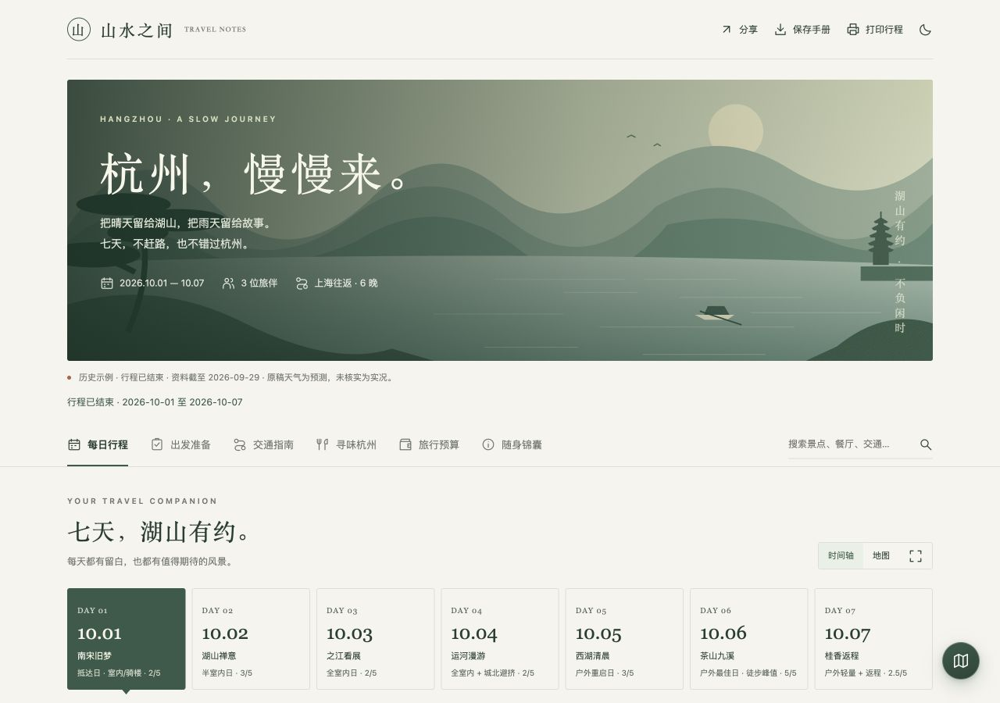
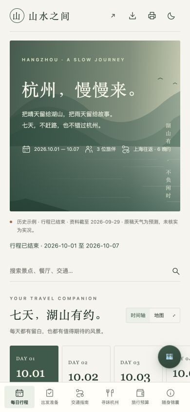
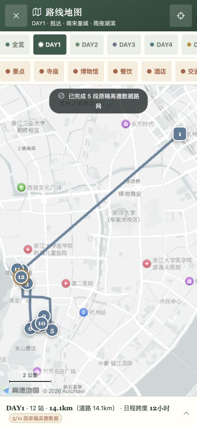

# Travel Guide Studio Skill

**English** | [简体中文](README.zh-CN.md)

An Agent skill that turns travel requirements or an existing guide into a **mobile-friendly, interactive travel handbook**. It includes the page template, geographic map module, blank input structure, data contract and a dependency-free Python renderer. The skill has no default destination, itinerary, prices, coordinates or map key. Showcase data lives separately in `examples/` and is excluded from the skill ZIP.

[**Live mobile preview**](https://chenchen428.github.io/travel-guide-studio-skill/) · [Full Hangzhou example](https://chenchen428.github.io/travel-guide-studio-skill/hangzhou-guide.html#trip) · [Download the skill](https://chenchen428.github.io/travel-guide-studio-skill/downloads/travel-guide-studio.zip) · [SKILL.md](SKILL.md)

## Install with your Agent

Copy this line and paste it into your Agent. Installation steps live in the [installation guide](docs/install.md); the [Pages preview](https://chenchen428.github.io/travel-guide-studio-skill/) also has a copy button.

```text
Install the skill using this guide: https://chenchen428.github.io/travel-guide-studio-skill/install.md
```



 

 

These are browser screenshots of the designed handbook generated by this skill. The live Pages site shows the interactive handbook: directly filling the screen on mobile, or inside a mobile frame on desktop.

## What the skill produces

- A daily timeline with transport, meals, rest, effort scores and alternatives for weather, reservation or stamina changes.
- A warm paper, forest-green and terracotta page design with an original embedded SVG illustration.
- Geographic maps with trip/day/alternative routes, category filters, numbered stops, place details, segment distances, fullscreen and a location entry.
- Preparation checklists, departure status, search, source explanations, copy/call/map links, budget options and duplicate-cost warnings.
- First-visit loading feedback, reading-position restoration per section, local theme/checklist persistence, native sharing, single-file downloads and full-itinerary printing.

Research and itinerary planning are performed by the Agent. The supplied template and scripts generate the page and its browser interactions. The skill does not provide ticket inventory, reservations, payments, accounts or cross-device synchronization.

## Examples

### Hangzhou: a complete seven-day handbook

[Open the designed handbook](https://chenchen428.github.io/travel-guide-studio-skill/hangzhou-guide.html#trip) · [Open its map](https://chenchen428.github.io/travel-guide-studio-skill/hangzhou-guide.html#trip-map)

The example adapts this [public seven-day Hangzhou guide](https://nua2fynhvu1g.meoo.pub/#tab-trip). It covers three travelers, a Shanghai round trip, seven days and six nights, October 1–7, 2026. Its source material is dated **September 29, 2026**.

| Preserved content and interactions | Scope |
|---|---|
| Daily timeline | 7 days, 66 time slots |
| Geographic data | 159 places, 81 day-route stops |
| Map modes | Overview, 7 days and 4 alternatives: Liangzhu, Xixi, osmanthus Plan B and Qiandao Lake |
| Category filters | Attractions, temples, museums, food, hotels, transit, shows, shopping and parks |
| Preparation | 5 priority tasks and 25 reservation tasks, with separate progress |
| Budget | 3 tiers, all 11 original options and included/duplicate-cost warnings |
| Opening hours | 28 places, including last-entry and holiday/closure notes |
| Mobile layout | Checked at 375, 390 and 430px; bottom navigation, horizontal dates and mobile map details |

This is a **historical example**, not a current travel recommendation. Weather is the original forecast. Prices, hours and source labels were not independently rechecked during the visual adaptation. Road polylines use the original precomputed data; mountain, water and missing-road segments clearly use straight-line estimates rather than live traffic.

### Suzhou: an undated draft

[View the draft](https://chenchen428.github.io/travel-guide-studio-skill/suzhou-draft.html) · [Input JSON](examples/suzhou-draft.json)

A two-day, one-night example demonstrates `date: null`, explicit unknowns and different budget calculation bases. Candidate places and budget allocations are unverified. Map configuration is missing and is explicitly marked as pending. This demonstrates draft handling rather than a finished itinerary.

## Use with an Agent

The skill works with Agents that support `SKILL.md`. Clone the repository into a skill directory or unzip the download:

```bash
git clone https://github.com/chenchen428/travel-guide-studio-skill.git travel-guide-studio
```

For Codex, place the skill at `~/.codex/skills/travel-guide-studio`. No npm installation is required. The repository name identifies it as a skill; its invocation name remains **`$travel-guide-studio`**.

Example request:

> Use $travel-guide-studio to turn this existing travel guide into a mobile-friendly handbook. Preserve its maps, routes, budget, preparation tasks and source interactions. Return the generated HTML for review.

> Use $travel-guide-studio to plan a relaxed two-day, one-night Suzhou trip for three travelers from Shanghai. Dates are undecided. Mark unknowns and prepare real map data before delivering a complete preview.

[Skill workflow](SKILL.md) · [Data contract](references/data-contract.md) · [Capability descriptions](references/capabilities.md)

## Generate a page directly

Python 3.9+ is required. The renderer has no third-party dependencies:

```bash
cp assets/trip-template.json trip.json
# Fill trip.json from your own requirements and verified sources.
python3 scripts/render.py trip.json travel-guide.html
```

The blank structure must be filled before rendering. The generator reads only the explicit input file; it never falls back to a showcase case. Costs can be per person, per accommodation night, per trip or per person-day. The group total is calculated from individual items; rounding is applied only to displayed per-person amounts.

For a new destination, verify current facts, obtain actual coordinates/routes, configure your own AMap browser JS key and adapt the illustration. The example inherits the public browser configuration of its reference page. No server API key or security secret is included; do not assume the example's Hangzhou data or browser configuration applies elsewhere.

The handbook embeds its application code, icons, illustration, coordinates and precomputed routes. AMap's SDK is loaded over the network when the map is first opened. Reading material remains available offline. Location is requested only after the user activates the location entry.

## GitHub Pages

[The Pages site](https://chenchen428.github.io/travel-guide-studio-skill/) focuses on the effect. Mobile visitors see the handbook filling the screen, with a persistent header and bottom navigation. Desktop visitors see one mobile frame plus the Agent-install prompt and source/download links. Documentation lives in the English and Chinese READMEs.

Pages publishes **`main` → `/docs`**:

- `docs/index.html`: the mobile preview shell.
- `docs/hangzhou-guide.html`: the complete designed example.
- `docs/suzhou-draft.html`: the undated draft.
- `docs/skill/`: the full skill and resources, accessible by URL.
- `docs/downloads/travel-guide-studio.zip`: the installable skill package.

Online skill entry: [SKILL.md](https://chenchen428.github.io/travel-guide-studio-skill/skill/SKILL.md). Its relative template, script and reference links are also accessible.

After changing the skill or example data:

```bash
python3 scripts/build_pages.py
```

This regenerates the examples, copies skill resources and rebuilds the download ZIP. Commit and push to `main` to trigger Pages deployment. No server application is required.

## Review the effect

1. Open the mobile preview or the standalone guide, then switch itinerary dates.
2. Tap “路线地图” on the first screen to open the trip overview; try day/alternative routes, category filters and place details.
3. Search for “九溪”, expand alternatives, and refresh after checking preparation tasks.
4. Change budget people/tiers/options; review the totals and included-cost warnings.
5. Try source explanations, copying, theme switching, download and print.

[Validation notes](docs/verification.md). Location requires browser permission, and sharing destinations are selected by the user; reviewing the page does not require sharing personal location or sending a message.

## Files

```text
travel-guide-studio/
├── SKILL.md
├── agents/openai.yaml
├── assets/{page-template.html,trip-template.json,route-map.js,route-map.css}
├── references/{capabilities.md,data-contract.md}
├── scripts/{render.py,build_pages.py}
├── examples/{hangzhou.json,suzhou-draft.json}
├── docs/{index.html,hangzhou-guide.html,suzhou-draft.html,skill/,downloads/,images/}
├── README.md
└── README.zh-CN.md
```

## Attribution

The Hangzhou content, coordinates and map foundation are adapted from the linked public reference. The page layout, original SVG illustration and skill contract were prepared in this project. AMap and community material retain their respective sources; source labels do not imply fresh verification. The landscape illustration is an original impression, not a photograph.
